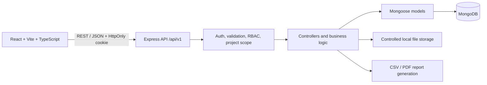
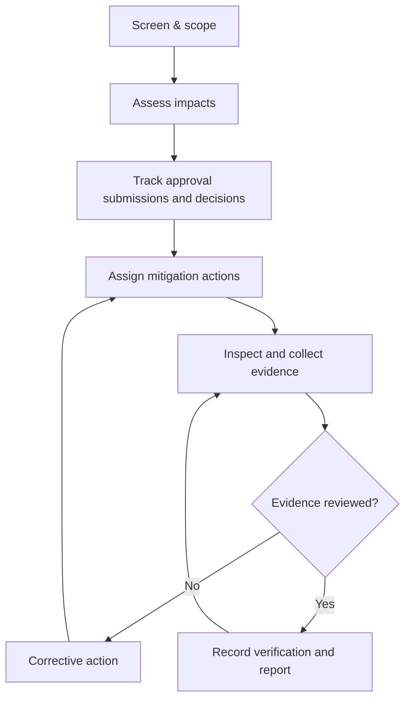

# Architecture



The browser calls the Express REST API. Authentication middleware verifies the session JWT and loads the active user. Role middleware and project membership checks authorize protected actions. Mongoose validates and persists records. Uploaded file contents remain in a controlled local directory while metadata and a generated storage name are stored in MongoDB.

## Authentication flow
```mermaid
sequenceDiagram
 participant U as User
 participant R as React
 participant A as Express API
 participant D as MongoDB
 U->>R: Submit email and password
 R->>A: POST /auth/login
 A->>D: Find user by normalized email
 D-->>A: Password hash and account status
 A->>A: Verify Argon2 hash; sign short-lived JWT
 A-->>R: HttpOnly session cookie + safe user profile
 R->>A: Request protected API
 A->>A: Verify cookie and authorization scope
 A-->>R: Authorized resource or safe error
```

## Compliance lifecycle

