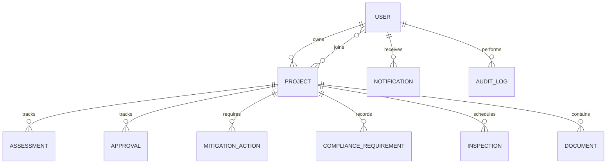

# MongoDB database design

EcoTrack uses MongoDB and Mongoose (no SQL database or Prisma). Collections: `users`, `projects`, `assessments`, `approvals`, `mitigationactions`, `compliancerequirements`, `inspections`, `documents`, `notifications`, and `auditlogs`.

Projects reference their owner and member users. Environmental records reference a project and, where applicable, their author or responsible user. Documents store metadata and a generated local storage name; file bytes are stored in `UPLOAD_DIR`, not in MongoDB. Notifications use a unique sparse `dedupeKey` to support idempotent reminders. Project codes and user emails are unique. Records use timestamps and project/status indexes.

Risk prioritization uses severity (1–5) multiplied by likelihood (1–5), giving 1–25. This is a management aid only, not an official environmental determination. MongoDB references are validated in application services because MongoDB does not enforce relational foreign keys. Use a replica set if adding multi-document transactions.
